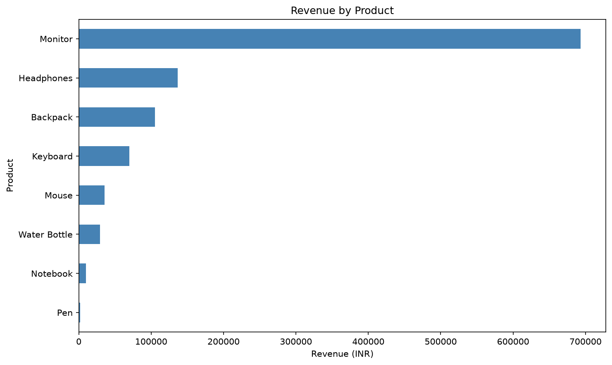

# Retail Sales Data Cleaning & Analysis

A beginner-friendly data analytics project demonstrating how raw retail sales data can be cleaned, validated, analyzed, and converted into actionable business insights using Python.

> **Dataset notice:** This project uses synthetic data generated for educational and portfolio purposes. It does not represent a real business.

## Project Overview

Retail businesses often work with spreadsheets containing duplicate records, missing values, invalid quantities, and inconsistent sales amounts.

This project demonstrates a repeatable workflow to identify data quality issues, clean the dataset, calculate sales metrics, and summarize findings for business decision-making.

## Business Questions

- What is the total sales revenue?
- Which products generate the most revenue?
- Which cities contribute the most revenue?
- How does revenue change month by month?
- What data quality issues need attention?

## Key Results

| Metric | Result |
|---|---:|
| Total Revenue | ₹10,81,230 |
| Unique Orders | 198 |
| Units Sold | 612 |
| Average Order Value | ₹5,460.76 |
| Cleaned Records | 198 |

### Key Findings

- **Top product by revenue:** Monitor — ₹6,93,500.
- **Top city by revenue:** Kolkata — ₹3,98,260.
- **Highest-revenue month:** January 2026 — ₹4,91,590.
- **Data quality:** Two exact duplicate records were removed, one invalid-quantity record was excluded, and one record with a missing product was excluded.

These findings describe the synthetic dataset and should not be interpreted as real market trends.

## Project Structure

```text
retail-sales-analysis/
├── data/
│   ├── raw_sales_data.csv
│   └── cleaned_sales_data.csv
├── notebooks/
├── reports/
│   ├── business_summary.md
│   └── revenue_by_product.png
├── generate_dataset.py
├── inspect_data.py
├── clean_data.py
├── analyze_sales.py
├── test_pandas.py
├── requirements.txt
└── README.md
```

## Technologies Used

- Python
- Pandas
- Matplotlib
- CSV data processing
- Git and GitHub

## Data Cleaning Workflow

1. Loaded the raw CSV dataset using Pandas.
2. Inspected dataset dimensions, columns, data types, and missing values.
3. Identified duplicate rows and invalid quantities.
4. Standardized blank text values as missing values.
5. Removed records with duplicate rows, missing products, or invalid quantities.
6. Replaced missing city information with `Unknown`.
7. Recalculated `Total_Amount` as `Quantity × Unit_Price`.
8. Converted the date column to a datetime format.
9. Exported the cleaned dataset as a separate CSV file.

The raw dataset is preserved so the cleaning process can be reproduced.

## Visualization

The project generates a horizontal bar chart showing revenue by product.



## Business Recommendations

1. Investigate the high concentration of revenue in the Monitor product.
2. Compare profit margins before making product or inventory decisions.
3. Examine monthly sales fluctuations using additional historical data.
4. Build a recurring sales dashboard to monitor revenue and product performance.

## Getting Started

### 1. Clone the repository

```bash
git clone YOUR_GITHUB_REPOSITORY_URL
cd retail-sales-analysis
```

Replace `YOUR_GITHUB_REPOSITORY_URL` with your actual GitHub repository URL.

### 2. Create and activate a virtual environment

**Windows PowerShell**

```powershell
python -m venv .venv
.\.venv\Scripts\Activate.ps1
```

**Ubuntu/Linux**

```bash
python3 -m venv .venv
source .venv/bin/activate
```

### 3. Install dependencies

```bash
python -m pip install -r requirements.txt
```

### 4. Generate the dataset

```bash
python generate_dataset.py
```

### 5. Inspect and clean the data

```bash
python inspect_data.py
python clean_data.py
```

### 6. Run the sales analysis

```bash
python analyze_sales.py
```

The generated chart is saved to the `reports/` directory.

## Limitations

- The dataset is synthetic.
- Revenue does not represent profit.
- Only three months of sales data are included.
- The findings are for demonstration purposes, not real business decisions.

## Author

**Habibur Saikh**

Data analytics portfolio project focused on data cleaning, exploratory analysis, and business reporting.
